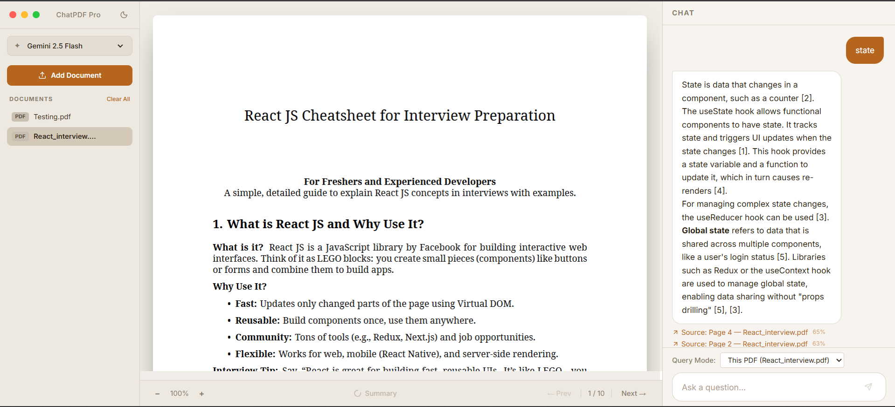
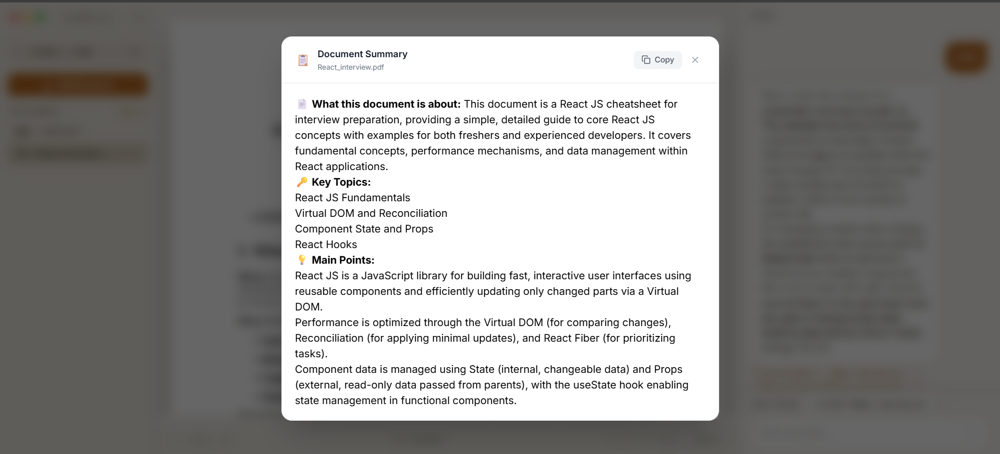

# PDFChat

**Intelligent Document Analysis Through Conversational AI** — Transform static PDFs into interactive knowledge bases with AI-powered retrieval and contextual answers.

---


## 🚀 Overview

PDFChat lets you hold natural language conversations with your PDFs. Instead of manually searching through pages, ask complex questions and get precise answers with source citations you can click through to the exact page.

**Problem Solved**: Traditional PDF readers offer basic text search, but fail at understanding context, relationships between concepts, or answering nuanced questions. PDFChat bridges this gap by retrieving the most relevant passages and letting a frontier model reason over them.

**Real-World Impact**: Ideal for researchers analyzing academic papers, professionals reviewing contracts, students studying textbooks, or anyone who needs to extract insights from dense documentation quickly.

---

## ✨ Key Features

- **📊 Sentence-aware chunking**: Splits each page into ~1000-character chunks with 100-character overlap, snapped to the nearest sentence boundary so a chunk never cuts a sentence in half; the page number and character offsets of every chunk are kept
- **🔀 Hybrid retrieval**: Combines cosine similarity over local lexical embeddings (40%) with weighted keyword matching (60%) to rank relevant chunks
- **💬 Streaming AI answers**: Real-time token streaming over Server-Sent Events, powered by Google Gemini with automatic retry on 429/503 and network failures
- **🧠 Conversation memory**: The last 20 turns are replayed to the model so follow-up questions resolve pronouns and references
- **📍 Precision citations**: Only chunks the model actually cited (`[1]`, `[2]`, …) are returned, each with page number, matched sentence, and a confidence score
- **🧠 Click-to-source**: Clicking a citation opens the source PDF at the cited page with the matching text highlighted
- **📄 AI document summaries**: One-click structured summary generated per document, shown in a modal on upload
- **💡 Suggested follow-ups**: Up to 3 AI-generated next questions, each validated against the document so you never get a dead-end suggestion
- **🎯 Single or all documents**: Scope a question to the selected PDF or query across your whole library
- **🔧 Model flexibility**: Switch between Gemini 2.5 Flash (fast) and 2.5 Pro (deeper) at any time
- **📱 Adaptive UI**: Light/dark themes, sidebar drawer on tablet, tab-based Docs / PDF / Chat navigation on mobile
- **🗂️ Library management**: Upload, delete individual documents, or clear the whole library (files and chunks together)
- **💾 Persistent chats**: Messages stored in SQLite and reloaded on refresh
- **🔐 Token authentication**: The UI shows a login screen when auth is enabled; every request (API, SSE stream, and PDF fetch) carries `Authorization: Bearer <token>`. `AUTH_TOKEN` gives one shared workspace, `AUTH_TOKENS` maps each token to a distinct user id for real isolation. Required in production.
- **📤 Resilient uploads**: Uploads run over `XMLHttpRequest` so the zone can show a live progress bar, retry automatically up to 3 times with linear backoff on network or server failure, and surface the server's error message with a manual "Retry" button
- **🛡️ Hardened request handling**: Content-Security-Policy on every response, model-authored Markdown links restricted to `http(s)`, a per-user upload quota, a 120s hard cap on chat streams, and strict tenant scoping on every document/chat read and delete
- **📃 Paginated reads**: `GET /api/documents` and `GET /api/chats/:chatId` accept `limit` / `offset`, so large libraries and long chat histories can be paged instead of loaded in one shot

---

## 🧠 System Architecture

### High-Level Overview

A single Node process serves both the API and the React SPA. Vite runs in middleware mode, so development and "start" behave the same way — there is no separate frontend server to launch.

### Architecture Diagram

```
┌─────────────────┐    ┌──────────────────────┐    ┌─────────────────┐
│   React UI      │    │   Express API        │    │   Gemini API    │
│   (Vite SPA)    │◄──►│   (same Node process)│◄──►│   (text only)   │
│                 │    │                      │    │                 │
│ - PDF Viewer    │    │ - /api/upload        │    │ - Chat stream   │
│ - Chat + SSE    │    │ - /api/chat (SSE)    │    │ - Summaries     │
│ - Upload Zone   │    │ - /api/documents/*   │    │ - Suggestions   │
│ - Summary modal │    │ - /api/chats/*       │    │                 │
└─────────────────┘    └──────────┬───────────┘    └─────────────────┘
                                  │
                     ┌────────────────────────────┐
                     │   Local (no external DB)  │
                     │                            │
                     │ - better-sqlite3          │
                     │   documents / chunks /    │
                     │   chats / messages        │
                     │ - uploads/ (PDF files)    │
                     │ - local lexical embedding │
                     │   + hybrid scoring        │
                     └────────────────────────────┘
```

### Component Breakdown

#### Frontend (`src/`)

- **React 19 + TypeScript + Vite** — component architecture with hooks, no global state library
- **PDF rendering** — `react-pdf` renders the uploaded file and highlights the cited sentence
- **Chat interface** — reads the SSE stream with a `ReadableStream` reader, renders answers as Markdown (`react-markdown`)
- **Layout** — three breakpoints: fixed sidebar + split view (desktop), drawer + split view (tablet), bottom-tab single panel (mobile)
- **Theming** — token maps for light/dark applied with `clsx`, plus `data-theme` and `color-scheme` on `<html>`

#### Backend (`server.ts`, `src/server/`)

- **API server** — Express with JSON body parsing, Multer uploads, and SSE streaming for chat
- **Guardrails** (`server.ts`) — token auth middleware, CSP header, per-IP rate limiting on AI endpoints, per-user upload quota, upload magic-byte validation, and a hard timeout on chat streams
- **Ingestion** (`ingestion.ts`) — PDF.js text extraction per page, then chunking (`chunking.ts`), embedding (`embedding.ts`), and batch insert
- **Retrieval** (`vector.ts`) — scoped SQL fetch, hybrid similarity scoring (`similarity.ts`), relevance gate, returns top-K
- **Chat orchestration** (`chat.ts`) — prompt assembly, Gemini streaming with retry, citation parsing, source payloads
- **Prompts** (`prompts.json`) — system instruction, summary format, and suggestion prompt kept out of the code
- **Persistence** (`db.ts`) — `better-sqlite3`, synchronous prepared statements, tables auto-created on boot, user-scoped data when auth enabled

### Data Flow Architecture

#### Document Ingestion

```
PDF Upload (PDF-only, magic-byte checked, 50MB limit, per-user quota) → PDF.js text extraction (per page)
           → Chunking (≤1000 chars, 100 overlap, snapped to sentence boundaries)
           → Lexical embedding v2 (768-dim) → SQLite insert (content, page, offsets, vector)
```

Embeddings are computed **locally** — no embedding API is called during ingestion. Each chunk records the `embedding_version` it was built with; chunks from an older algorithm are transparently re-embedded on boot. Re-indexing runs *after* the server starts accepting connections and processes chunks in batches of 50 that yield to the event loop, so a large backlog never blocks startup.

#### Query Processing

```
User query → Local lexical embedding → Hybrid scoring (0.4·cosine + 0.6·keyword)
           → Relevance gate (hybrid score > 0.1) → Top 5 chunks → Numbered context [1]…[5] in system instruction
           → Gemini stream → SSE text frames → final sources frame
```

#### Response Delivery

```
Token frames ──────────────► streaming Markdown render
Sources frame (post-stream) ► citation chips with confidence %
                            ► click → PDF panel jumps to page + highlights sentence
```

### Key Design Decisions

- **Hybrid retrieval weighting** — keyword score is weighted 60% because the local embedding captures lexical structure (word tokens, character trigrams, word bigrams) rather than true semantics; keyword matching carries most of the retrieval signal
- **Relevance gate** — a chunk must clear a hybrid score of `0.1` before it can reach the model, so weak matches never enter the prompt. The threshold was loosened from `0.15` (with a mandatory keyword hit) to `0.1` because the tightened rule discarded chunks that matched strongly on the vector term alone
- **Positional keyword weighting** — earlier query words weigh more (`1/(i+1)`), so the first terms in a question dominate matching
- **Citation parsing** — the model is asked to cite `[n]`; only those chunks are returned as sources, with the sentence best matching the question used as the preview
- **Chunking** — ~1000 characters with 100 characters of overlap, per page, retaining character offsets for locating text in the viewer. The window end is snapped back to the last sentence boundary (searching up to 200 characters) so chunks stay semantically whole, and the cursor is advanced to `end - overlap` to guarantee forward progress
- **Bounded concurrency** — chunks are embedded and inserted in batches of 5
- **Upload resilience** — `fetch` cannot report upload progress, so the upload zone uses `XMLHttpRequest` for byte-level progress and retries failed requests (network errors and 4xx/5xx) up to 3 times with 1s/2s/3s backoff before surfacing the error
- **Defense in depth** — CSP blocks injected scripts, Markdown links are filtered to `http(s)` so a malicious model answer cannot ship a `javascript:` URL, the PDF viewer refreshes its auth headers when the token changes, and AI endpoints are rate limited per IP
- **No external services** — storage, retrieval, and embeddings are all local, so the only network dependency is the Gemini API
- **Retry policy** — 3 attempts with 3s/6s backoff for 429/503 and network-level errors; failures are surfaced to the UI as an SSE `error` frame, and a hard 120s timeout closes a stream that stalls

---

## ⚙️ Tech Stack

### Frontend

- **React 19** — component architecture with hooks
- **TypeScript** — type-safe components and API layer
- **Vite 6** — dev server in middleware mode + production bundler
- **Tailwind CSS 4** — utility styling via `@tailwindcss/vite` (no `tailwind.config.js`), with `@tailwindcss/typography` for rendered Markdown
- **@fontsource/inter** — self-hosted Inter font, no external font CDN
- **react-pdf** — client-side PDF rendering
- **react-markdown** — Markdown rendering for streamed answers
- **lucide-react** — icons
- **clsx** — conditional class composition

### Backend

- **Node.js** (20.x / 22.x+) with **tsx** for TypeScript execution
- **Express 4** — REST API + SSE
- **better-sqlite3** — embedded database (`database.sqlite`)
- **multer** — multipart PDF uploads to `uploads/`
- **pdfjs-dist** (legacy build) — server-side text extraction
- **@google/genai** — Gemini SDK for chat, summaries, and suggestions
- **dotenv** — loads `.env` before the server starts
- **uuid** — document/chunk/message IDs

### AI & Data

- **Google Gemini API** — `gemini-2.5-flash` (default) and `gemini-2.5-pro`
- **Local lexical embedding** — 768-dimension token/n-gram hash vectors, L2-normalized (no external embedding provider), versioned for automatic re-indexing
- **SQLite vector store** — embeddings stored as JSON in the `chunks` table; retrieval is scoped in SQL and parsed vectors are cached in memory

---

## 📸 Screenshots

Upload and chat:



AI document summary:



---

## 🛠️ Installation & Setup

### Prerequisites

- **Node.js ≥ 20** (20.19+ or 22.12+ recommended — required by `better-sqlite3` and `@vitejs/plugin-react`)
- **npm**
- **Google Gemini API key** — free tier at [Google AI Studio](https://aistudio.google.com/app/apikey)

### Quick Start

1. **Clone and navigate**

   ```bash
   git clone <repository-url>
   cd PDFChat
   ```

2. **Install dependencies**

   ```bash
   npm install
   ```

3. **Configure environment**

   ```bash
   cp .env.example .env      # macOS / Linux
   copy .env.example .env    # Windows PowerShell / CMD
   ```

   Then edit `.env`:

   ```env
    GEMINI_API_KEY=your_api_key_here
    # Optional: DISABLE_HMR=true to turn off Vite HMR
    # Auth (required in production): AUTH_TOKEN=<token> or
    #   AUTH_TOKENS=<token>:<userId>,<token2>:<userId2> for multiple users
    # Optional: MAX_FILES_PER_USER=100 to cap documents per user
    # Optional: HOST=0.0.0.0 to expose on the LAN (defaults to 127.0.0.1)
    # Optional: PORT=3000
    ```

   The server binds to `127.0.0.1` by default. Set `HOST=0.0.0.0` when running in a
   container or testing from another device.

   `MAX_FILES_PER_USER` caps how many documents a single user may store (default `100`).
   The quota is only enforced when authentication is enabled.

4. **Start the server**

   ```bash
   npm run dev
   ```

5. **Open the app**

   Visit [http://localhost:3000](http://localhost:3000), upload a PDF, and start asking questions.

### npm Scripts

| Script | Command | Notes |
| --- | --- | --- |
| `npm run dev` | `tsx server.ts` | Express API + Vite middleware, HMR enabled |
| `npm run build` | `vite build` | Bundles the SPA into `dist/` |
| `npm run lint` | `eslint .` | ESLint (typescript-eslint + react-hooks) |
| `npm run typecheck` | `tsc --noEmit` | Type check only |
| `npm test` | `vitest run` | Unit tests for the pure server logic |
| `npm run test:watch` | `vitest` | Unit tests in watch mode |
| `npm start` | `tsx server.ts --prod` | Serves the built `dist/` output (`npm run build` first) |
| `npm run clean` | `node -e "…rmSync('dist')"` | Cross-platform (Node) |

> **Note**: Run `npm run build` before `npm start`. In production mode the server serves the static `dist/` bundle; if `dist/index.html` is missing it exits with an error. Development (`npm run dev`) still uses Vite middleware.

### Runtime Artifacts

These are created on first run and are git-ignored:

- `database.sqlite` — documents, chunks, embeddings, chats, messages
- `uploads/` — uploaded PDFs under generated UUID filenames

---

## 📌 Usage

### Basic Workflow

1. **Upload** — drag & drop or select a PDF (PDF only). A progress bar tracks the transfer, failed uploads are retried automatically (or manually via the inline "Retry" button), and a summary is generated on completion.
2. **Scope** — pick a document in the sidebar to query it alone, or use "All documents" to search across the library.
3. **Ask** — type a question, or click one of the suggested follow-ups.
4. **Verify** — read the answer and its citations; each chip shows a confidence score and the matched sentence.
5. **Navigate** — click a citation to jump to that page in the PDF panel with the text highlighted.

### Query Examples

- **Summarization** — "Summarize the key arguments against the proposed solution"
- **Cross-reference** — "Compare the approaches in chapters 3 and 5"
- **Locate evidence** — "What evidence supports the hypothesis on page 12?"
- **Cross-document** — in "All documents" mode: "Which documents mention the same methodology?"

### Model Selection

- **Gemini 2.5 Flash** (default) — fast, used for chat, summaries, and suggestions
- **Gemini 2.5 Pro** — slower, deeper reasoning for complex or technical questions

### API Reference

| Method | Endpoint | Description |
| --- | --- | --- |
| `GET` | `/api/auth/status` | Public. Returns `{ required, authenticated }` so the UI knows whether to show the login screen |
| `POST` | `/api/upload` | Multipart `file` upload (PDF-only, 50MB); ingests and indexes the PDF. Protected if auth enabled. |
| `GET` | `/api/documents` | List indexed documents; accepts optional `?limit=` and `?offset=` |
| `GET` | `/api/documents/:id/content` | Stream the stored PDF |
| `DELETE` | `/api/documents/:id` | Delete a document, its chunks, and its file |
| `DELETE` | `/api/documents` | Delete all documents and uploaded files |
| `POST` | `/api/chats` | Create a chat session |
| `GET` | `/api/chats/:chatId` | Fetch message history for a chat; accepts optional `?limit=` and `?offset=` |
| `PATCH` | `/api/chats/:id/title` | Rename a chat |
| `POST` | `/api/chat` | `{ message, chatId, mode, pdf_id?, model? }` → SSE stream of `text` frames then a `sources` frame |
| `POST` | `/api/documents/:id/summary` | Generate a document summary |
| `POST` | `/api/documents/:id/suggestions` | Generate validated follow-up questions for one document |
| `POST` | `/api/suggestions` | Follow-up questions; scope to `pdf_id` or omit it to span every document |

### Project Structure

```
.
├── server.ts              # Express app, routes, Vite middleware
├── src/
│   ├── App.tsx            # Layout, theming, document/chat state
│   ├── components/        # ChatInterface, PDFViewer, UploadZone, SummaryModal
│   ├── hooks/useChat.ts   # SSE consumption, message state, suggestions
│   ├── lib/api.ts         # Typed fetch wrappers
│   └── server/            # Server modules (see below)
│       ├── db.ts          # SQLite schema + prepared statements
│       ├── ingestion.ts   # PDF text extraction, chunking, embedding, insert
│       ├── chunking.ts    # Pure page-aware, sentence-aligned chunking (1000/100)
│       ├── embedding.ts   # Local lexical embedding (768-dim, versioned)
│       ├── vector.ts      # Hybrid retrieval + relevance gate
│       ├── similarity.ts  # Pure cosine + keyword scoring helpers
│       ├── util.ts        # Safe error messages, even sampling
│       ├── chat.ts        # Gemini streaming, citations, sources
│       ├── prompts.json   # System / summary / suggestion prompts
│       └── *.test.ts      # Vitest unit tests for the pure logic
├── eslint.config.js       # ESLint (typescript-eslint + react-hooks)
├── vitest.config.ts       # Vitest config
├── database.sqlite        # Generated
├── uploads/               # Generated
└── .env.example
```

---

## 🚧 Challenges & Learnings

**PDF text extraction**: Text layer quality varies widely across PDFs (scans, broken encodings, multi-column layouts). The extractor joins PDF.js text items with spaces, which is reliable for born-digital documents but degrades on scanned ones — OCR would be the next step.

**Retrieval without a real embedding model**: The local 768-dim vector hashes word tokens, character trigrams and word bigrams — more signal than a plain character hash, but still lexical rather than semantic. It is fast, dependency-free and (via `embedding_version`) automatically re-indexed when the algorithm changes, but it cannot match synonyms or paraphrase, which is exactly why keyword matching is weighted more heavily in the hybrid score.

**Relevance gating matters**: Returning the top-5 chunks unconditionally injected unrelated context into prompts. Requiring a keyword hit and a minimum hybrid score measurably reduced off-topic answers. The rule was later relaxed to a pure score threshold (`> 0.1`) after it turned out to discard chunks that matched strongly on the vector term alone — a good reminder that a gate tuned for one embedding algorithm needs re-tuning when the algorithm changes.

**Chunk boundaries decide answer quality**: Fixed-width windows cut sentences in half, so a retrieved chunk could carry a fragment instead of a complete claim. Snapping the window end to the nearest sentence boundary keeps chunks self-contained, and advancing the cursor by `end - overlap` guarantees the loop always makes progress.

**Uploads fail in ways `fetch` hides**: `fetch` gives no upload progress and reports every failure as a generic network error. Switching the upload zone to `XMLHttpRequest` exposed real byte-level progress and the server's error message, and made it cheap to add bounded retries with backoff — the single biggest perceived-reliability win in the app.

**Trust boundaries need to be enforced server-side**: Identity is derived from the token alone (never a client-supplied header), and every document/chat query is scoped to the caller's tenant id. Legacy documents uploaded before auth was enabled are backfilled to the single-token tenant on boot so they stay reachable without leaking to every caller.

**Citation integrity**: Trusting retrieved chunks as "sources" produced false attributions. Parsing `[n]` markers out of the model's own response and returning only those chunks keeps citations honest.

**Streaming resilience**: Transient 503/429 responses and dropped connections are common with the Gemini API. Retrying with backoff and forwarding errors as an SSE `error` frame keeps the UI responsive instead of hanging on a spinner.

**Retrieval scaling**: Retrieval is scoped to the caller's documents in SQL and parsed vectors are cached in memory (invalidated whenever chunks change), so unrelated libraries are never loaded. Scoring is still linear in the number of in-scope chunks — fine for a personal library, but an approximate nearest-neighbour index would be required at large scale.

---

## 🔮 Future Improvements

**Real embeddings**: Swap the local hash embedding for a hosted embedding model (Gemini, Vertex AI, or a local sentence-transformer) to capture semantic similarity.

**ANN vector index**: Move from full-table scans to an approximate nearest-neighbour index (e.g. sqlite-vec or a dedicated vector DB) for large libraries.

**Multi-modal ingestion**: Extract and describe images, charts, and tables via vision-language models.

**Richer context assembly**: Hierarchical chunking, query expansion, and multi-stage retrieval for long documents.

**Smarter memory**: Summarize or window long conversations so context survives beyond the last 20 turns.

**Paged clients**: The list endpoints already accept `limit` / `offset`; the UI still loads full libraries and histories, so virtual scrolling and infinite history belong here.

**Collaborative features**: Shared document workspaces, annotations, and per-document access control (token-scoped isolation already exists).

**Security & hardening**: Token rotation and refresh flows, a shared rate-limit store for multi-instance deployments, per-document access control, and audit logging.

---

## 👨‍💻 Author

Full-stack developer focused on AI-powered applications and developer experience.

_Built to demonstrate a practical retrieval-augmented generation pipeline: ingestion, hybrid retrieval, grounded generation, and verifiable citations._
